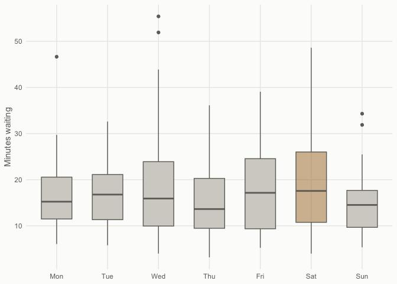
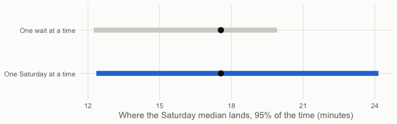

# Does my experience hold up?


> [!TIP]
>
> ### The short version
>
> I believed weekends were easier and late nights were slower. Two
> months of my own data supports neither.

## What I thought I knew

After two months of delivering, I had a few beliefs about when the waits
are long.

Weekends should be easier. More people order in, so the next order
should come sooner. On weekdays I usually stop around 8 pm, but on
weekends I keep going a little later, because it feels busier.

And the later it gets, the longer I wait.

Then I looked at my own data, and the first thing it showed me was that
Saturday had the longest waits of the week.

So which is it?

## What I mean by a wait

A wait is the time with no order in my car: from my last drop-off to the
next pickup. If I carry two orders at once, the time between them
doesn’t count. I’m still working.

It’s not how long the customer waits, and it’s not how long the store
takes. It’s how long I sit there.

## Looking at the numbers

<details class="code-fold">
<summary>Code</summary>

``` r
waits |>
  mutate(weekday = factor(weekday, levels = c("Mon","Tue","Wed","Thu","Fri","Sat","Sun")),
         saturday = weekday == "Sat") |>
  ggplot(aes(weekday, minutes, fill = saturday)) +
  geom_boxplot(colour = rv[["muted"]], outlier.colour = rv[["muted"]], width = 0.6) +
  # Held back, as the site draws a day that leans slower but is not clearly so.
  scale_fill_manual(values = c(`TRUE` = scales::alpha(rv[["amber"]], 0.45), `FALSE` = rv[["grey"]]), guide = "none") +
  labs(x = NULL, y = "Minutes waiting")
```

</details>



My median Saturday wait was 17.6 minutes. Every other day together:
15.1. Saturday is about 2.5 minutes slower.

But that’s two months, and only 8 Saturdays. How sure can I be about
that 2.5?

## Bootstrap: rebuilding the two months

I can’t drive the same two months twice. What I can do is rebuild them
from the data I already have, and see how much the answer changes.

The idea is simple. Take my real data, draw from it at random with
replacement, and build a new “two months” of the same size. Some days
show up twice, some not at all. Work out the Saturday median again. Do
that 10,000 times.

This doesn’t predict anything. It tells me how much my number moves when
the luck changes. If it barely moves, I can trust it. If it swings all
over, I can’t.

## What do you draw?

Here’s the part that surprised me. It matters *what* you draw.

If I draw single waits, I treat my 40 Saturday waits as 40 separate
pieces of evidence. But they aren’t. Waits on the same day share the
same weather, the same traffic, the same luck. A slow Saturday is slow
all day.

So I tried both: drawing one wait at a time, and drawing one whole
Saturday at a time.

<details class="code-fold">
<summary>Code</summary>

``` r
set.seed(1)
boot_by_wait <- replicate(10000,
  median(sample(sat_waits$minutes, replace = TRUE))
)

set.seed(1)
boot_by_day <- replicate(10000,
  median(unlist(sample(sat_by_day, length(sat_by_day), replace = TRUE)))
)

range_by_wait <- quantile(boot_by_wait, c(0.025, 0.975))
range_by_day  <- quantile(boot_by_day,  c(0.025, 0.975))

tibble(
  drawn = factor(c("One wait at a time", "One Saturday at a time"),
                 levels = c("One Saturday at a time", "One wait at a time")),
  lo = c(range_by_wait[1], range_by_day[1]),
  hi = c(range_by_wait[2], range_by_day[2])
) |>
  ggplot(aes(y = drawn, colour = drawn)) +
  geom_linerange(aes(xmin = lo, xmax = hi), linewidth = 3) +
  geom_point(aes(x = median(sat_waits$minutes)), size = 3, colour = rv[["ink"]]) +
  scale_colour_manual(values = c(`One Saturday at a time` = rv[["blue"]], `One wait at a time` = rv[["grey"]]), guide = "none") +
  labs(x = "Where the Saturday median lands, 95% of the time (minutes)", y = NULL)
```

</details>



Drawing single waits, the Saturday median lands between 12.2 and 19.9
minutes, 95% of the time. Drawing whole Saturdays, it’s 12.3 to 24.1.

Same data. A much wider range. Drawing single waits made me more sure
than I should be. From here on, I draw whole days.

## Saturday against the rest

<details class="code-fold">
<summary>Code</summary>

``` r
median_by_day <- function(rows) {
  by_day <- split(rows$minutes, rows$day)
  median(unlist(sample(by_day, length(by_day), replace = TRUE)))
}

set.seed(1)
diff_saturday <- replicate(10000,
  median_by_day(sat_waits) - median_by_day(oth_waits)
)
share_saturday <- mean(diff_saturday > 0)
range_saturday <- quantile(diff_saturday, c(0.025, 0.975))
```

</details>

Rebuild my two months 10,000 times, and Saturday comes out slower in 91
of every 100.

That sounds convincing. But the range runs from -2.3 to 9.7 minutes, and
it crosses zero. Saturday could be a lot slower, or a little faster.

> [!WARNING]
>
> ### A catch
>
> I only looked at Saturday *because* it was the highest of the seven
> days. Out of seven days, one will always come out on top, even if
> they’re all the same. Pick the winner after the race and it will look
> better than it is.

## My actual beliefs

So let me test what I really believed, set up before looking: weekends
against weekdays, and after 8 pm against earlier. The 8 pm line comes
from my own habit, not from the data.

<details class="code-fold">
<summary>Code</summary>

``` r
weekend_waits <- waits[waits$weekday %in% c("Sat", "Sun"), ]
weekday_waits <- waits[!waits$weekday %in% c("Sat", "Sun"), ]

set.seed(1)
diff_weekend <- replicate(10000,
  median_by_day(weekend_waits) - median_by_day(weekday_waits)
)

# Late and earlier waits share the same days, so draw the days once for both.
is_late <- function(h) h >= 20 | h < 5
waits_by_day <- split(waits, waits$day)
late_minus_earlier <- function(rows) {
  median(rows$minutes[is_late(rows$hour)]) - median(rows$minutes[!is_late(rows$hour)])
}

set.seed(1)
diff_late <- replicate(10000, {
  picked <- sample(waits_by_day, length(waits_by_day), replace = TRUE)
  late_minus_earlier(do.call(rbind, picked))
})

share_weekend <- mean(diff_weekend > 0)
share_late    <- mean(diff_late > 0)
```

</details>

50 means a coin flip. Far above 50 means slower; far below means faster.

| Belief                            | Out of 100 rebuilds, slower in |
|-----------------------------------|--------------------------------|
| Saturday is slower                | 91                             |
| Weekends are slower than weekdays | 45                             |
| After 8 pm is slower than earlier | 28                             |

Weekends and weekdays come out about even. Late nights are, if anything,
a little *shorter*.

## So did it hold up?

Not really.

Weekends weren’t easier, or harder. They were about the same. Late
nights weren’t worse. And Saturday, the one day that looked slow, was
the one I picked because it looked slow. Average it with Sunday, and
weekends look like every other day.

What I think happened: a few long nights stuck with me. The ordinary
ones didn’t.

Two months is not much, and 8 Saturdays is not much. None of this proves
the days are all the same. It just says my data can’t tell them apart
yet, and that the beliefs I’d built from driving were stronger than the
evidence behind them.

> Bootstrap didn’t give me an answer. It told me how much I didn’t know.
